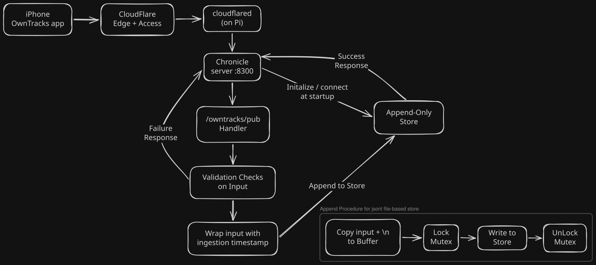
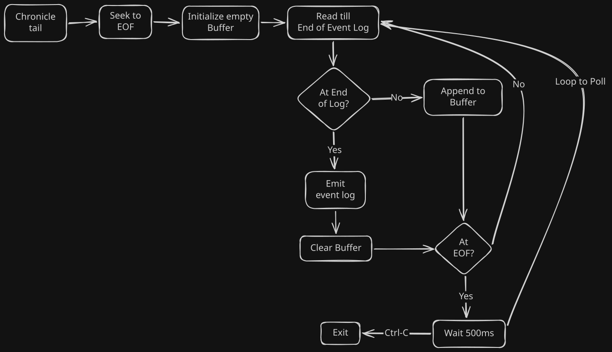

# Chronicle

A personal location store on a Raspberry Pi 4B, written in Go. The OwnTracks
iOS app posts each location point over HTTP. Chronicle appends each one to a
log on the Pi.

Chronicle is also a learning project: each milestone builds the ideas of one
or more chapters of *Designing Data-Intensive Applications* (1st ed.) from the
standard library up. This README records what each milestone built and how.
The design and the roadmap live in the
[design doc](https://claude.ai/code/artifact/b506277b-93bf-4e40-92e9-61c85b44f2c5).

## M0: ingest to a JSON-lines file (October 2026)



### What it does

1. The OwnTracks app posts JSON to `https://chronicle.neoquant.trade/owntracks/pub`.
2. The Cloudflare edge ends HTTPS. An Access app guards the hostname. A Bypass
   app lets `/owntracks/pub` through, because OwnTracks cannot log in to Access.
3. `cloudflared` on the Pi holds an outbound tunnel. It forwards the request to
   `127.0.0.1:8300`. No port is open on the router.
4. The handler checks the request: POST only (405), Basic auth compared in
   constant time (401), body at most 64 KiB (413), valid JSON (400).
5. It wraps the body as `{"ingest_time": <unix µs>, "body": <post>}` and
   appends it as one line to `/var/lib/chronicle/points.jsonl`.
6. Only after the append succeeds does it answer `200` with `[]`. A failed
   write answers `500`, so OwnTracks keeps the point and sends it again later.

### Packages

| Path | Role |
|---|---|
| `cmd/chronicle` | `serve` reads config from the environment, opens the store once, and starts the HTTP server. `tail [path]` prints new lines as they arrive, like `tail -f`. |
| `internal/owntracks` | The `/owntracks/pub` handler. It depends on a one-method `Appender` interface, so tests use a fake store. |
| `internal/jsonl` | `Writer`: append-only lines under a mutex, on a file opened with `O_APPEND`. `Follow`: reads new lines by polling. |
| `learn/` | Warm-up exercises before M0: pointers vs values, slice growth, a linked list, a hash map (chaining, FNV-1a). |
| `deploy/` | systemd unit, `deploy.sh`, and `.env.example`. |

### Reading the log: `chronicle tail`



`tail` opens the log, seeks to the end, and prints each new event as `serve`
appends it. A partial event stays in a buffer until the rest arrives. At EOF
it waits 500 ms, then reads again. Ctrl-C stops it.

### How it was built

In this order, one small commit per step:

1. Go module, Makefile (`make test lint`), and the `learn/` exercises.
2. The handler, tested with `httptest` before any server existed.
3. The JSON-lines writer, then the `serve` binary that wires the two together.
4. Local check with `curl`, then the Cloudflare Tunnel and Access apps.
5. The systemd unit and `deploy.sh`, then `tail` for watching points arrive.

Each bug fix starts with a failing test.

### Decisions and why

- **HTTP mode, not MQTT.** On iOS both modes behave the same, and HTTP needs
  no broker.
- **Cloudflare Tunnel, not Tailscale.** The phone posts to a public HTTPS
  hostname, and the Pi opens no inbound port.
- **The server checks auth itself on `/owntracks/pub`.** The Bypass app skips
  Access there, so Basic auth is the only guard on that path.
- **Store the raw body, plus `ingest_time`.** Nothing is parsed away, and
  ingest time minus the point's own timestamp gives lateness later.
- **Copy the line into a buffer before taking the lock.** The lock covers only
  the single `write` syscall.
- **The systemd unit is sandboxed.** The process can write only to
  `/var/lib/chronicle`, and cannot see the home folder, `.env` or the tunnel
  certificate.
- **No `-race`.** The Pi kernel uses 39-bit virtual addresses, and
  ThreadSanitizer needs 48.

### Known limits (for later milestones)

- No `fsync`. A `200` means the line reached the kernel's page cache, not the
  disk. A power cut can lose the most recent points. (DDIA ch. 3 and 7.)
- JSON lines are slow to scan and have no index. M1 replaces this file with a
  binary segment log.

## Run it

```sh
make test lint
make build
CHRONICLE_OT_USER=me CHRONICLE_OT_PASS=secret bin/chronicle serve
curl -u me:secret -d '{"_type":"location","lat":1,"lon":2,"tst":1}' http://127.0.0.1:8300/owntracks/pub
bin/chronicle tail
```

Deploy on the Pi: copy `deploy/.env.example` to `deploy/.env`, fill it in,
then run `deploy/deploy.sh`.
